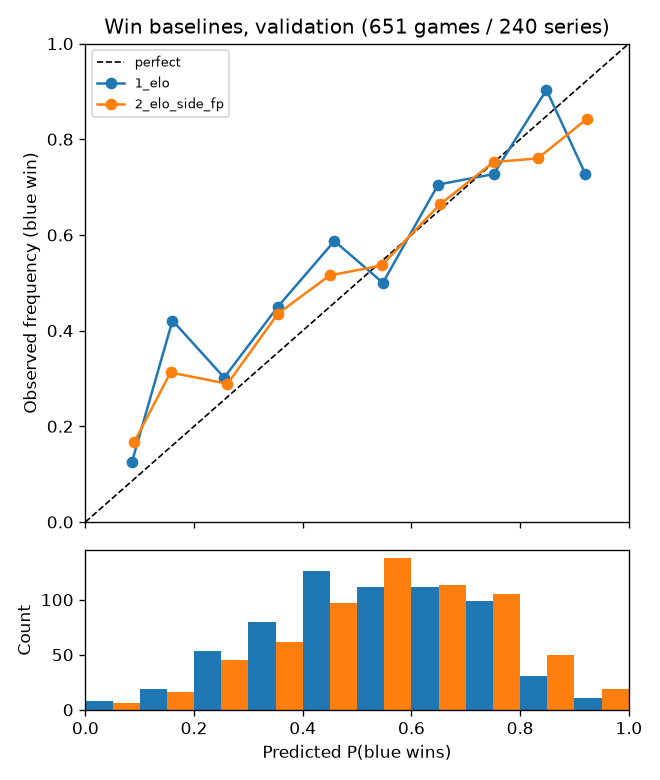

# M2 baselines

Generated by `python -m draft_analyzer.experiments m2`. All statistics are as-of (computed only from games that finished before each game started).

## Splits (by series start time)

| split | from | to | games | series | actions | candidate_rows |
|---|---|---|---|---|---|---|
| train | 2024-01-13 | 2026-07-19 | 6349 | 2626 | 126942 | 19898964 |
| val | 2026-07-22 | 2026-09-13 | 651 | 240 | 13018 | 1999546 |
| test | 2026-09-17 | 2026-11-09 | 172 | 66 | 3440 | 524240 |
| (tune, inside train) | 2026-04-01 | 2026-07-19 | 1087 | 425 | 21737 | 3357658 |

## Next action baselines (validation: 651 games / 240 series, 13015 actions)

- **A**: as-of patch presence (pick + ban rate; current patch shrunk toward the 60-day long-run rate with 20 pseudo-games), unavailable champions excluded.
- **B**: A plus the relevant team's recent pick frequency (acting team for a pick, opponent for a ban; 60-day half-life).
- Probabilities for log loss: `softmax(tau * log(stat + eps))` over available champions; `tau`, `eps` (and B's team weight `w`) fitted per action type on training games from 2025 on.

Fitted parameters (tau, eps, w): {"A_presence": {"ban": [2.5, 0.03, 0.0], "pick": [1.5, 0.01, 0.0]}, "B_presence_team": {"ban": [2.5, 0.03, 1.0], "pick": [2.0, 0.03, 2.0]}}

### A_presence

| group | slice | top1 | top5 | top10 | log_loss | n_actions | n_games | n_series |
|---|---|---|---|---|---|---|---|---|
| overall | all | 0.1088 | 0.3731 | 0.5604 | 3.5822 | 13015 | 651 | 240 |
| action_type | ban | 0.1422 | 0.4570 | 0.6492 | 3.3642 | 6505 | 651 | 240 |
| action_type | pick | 0.0754 | 0.2892 | 0.4716 | 3.8001 | 6510 | 651 | 240 |
| phase | ban1 | 0.1957 | 0.5711 | 0.7692 | 2.9833 | 3903 | 651 | 240 |
| phase | pick1 | 0.0960 | 0.3584 | 0.5420 | 3.6168 | 3906 | 651 | 240 |
| phase | ban2 | 0.0619 | 0.2859 | 0.4693 | 3.9355 | 2602 | 651 | 240 |
| phase | pick2 | 0.0445 | 0.1855 | 0.3660 | 4.0751 | 2604 | 651 | 240 |

### B_presence_team

| group | slice | top1 | top5 | top10 | log_loss | n_actions | n_games | n_series |
|---|---|---|---|---|---|---|---|---|
| overall | all | 0.1196 | 0.3965 | 0.5813 | 3.5275 | 13015 | 651 | 240 |
| action_type | ban | 0.1453 | 0.4652 | 0.6561 | 3.3227 | 6505 | 651 | 240 |
| action_type | pick | 0.0939 | 0.3278 | 0.5065 | 3.7322 | 6510 | 651 | 240 |
| phase | ban1 | 0.1996 | 0.5844 | 0.7745 | 2.9808 | 3903 | 651 | 240 |
| phase | pick1 | 0.1249 | 0.4017 | 0.5773 | 3.5272 | 3906 | 651 | 240 |
| phase | ban2 | 0.0638 | 0.2863 | 0.4785 | 3.8356 | 2602 | 651 | 240 |
| phase | pick2 | 0.0472 | 0.2170 | 0.4002 | 4.0397 | 2604 | 651 | 240 |

### B vs A (paired bootstrap by series, 2000 resamples, 95% CI on the difference)

| model | metric | value | diff | ci_low | ci_high | verdict |
|---|---|---|---|---|---|---|
| A_presence | top1 | 0.1088 | 0.0000 | 0.0000 | 0.0000 | baseline |
| A_presence | top5 | 0.3731 | 0.0000 | 0.0000 | 0.0000 | baseline |
| A_presence | top10 | 0.5604 | 0.0000 | 0.0000 | 0.0000 | baseline |
| A_presence | log_loss | 3.5822 | 0.0000 | 0.0000 | 0.0000 | baseline |
| B_presence_team | top1 | 0.1196 | 0.0108 | 0.0060 | 0.0154 | better |
| B_presence_team | top5 | 0.3965 | 0.0234 | 0.0174 | 0.0294 | better |
| B_presence_team | top10 | 0.5813 | 0.0209 | 0.0149 | 0.0267 | better |
| B_presence_team | log_loss | 3.5275 | -0.0547 | -0.0650 | -0.0441 | better |

picks only:

| model | metric | value | diff | ci_low | ci_high | verdict |
|---|---|---|---|---|---|---|
| A_presence | top1 | 0.0754 | 0.0000 | 0.0000 | 0.0000 | baseline |
| A_presence | top5 | 0.2892 | 0.0000 | 0.0000 | 0.0000 | baseline |
| A_presence | top10 | 0.4716 | 0.0000 | 0.0000 | 0.0000 | baseline |
| A_presence | log_loss | 3.8001 | 0.0000 | 0.0000 | 0.0000 | baseline |
| B_presence_team | top1 | 0.0939 | 0.0184 | 0.0117 | 0.0248 | better |
| B_presence_team | top5 | 0.3278 | 0.0386 | 0.0298 | 0.0481 | better |
| B_presence_team | top10 | 0.5065 | 0.0349 | 0.0251 | 0.0443 | better |
| B_presence_team | log_loss | 3.7322 | -0.0679 | -0.0815 | -0.0543 | better |

bans only:

| model | metric | value | diff | ci_low | ci_high | verdict |
|---|---|---|---|---|---|---|
| A_presence | top1 | 0.1422 | 0.0000 | 0.0000 | 0.0000 | baseline |
| A_presence | top5 | 0.4570 | 0.0000 | 0.0000 | 0.0000 | baseline |
| A_presence | top10 | 0.6492 | 0.0000 | 0.0000 | 0.0000 | baseline |
| A_presence | log_loss | 3.3642 | 0.0000 | 0.0000 | 0.0000 | baseline |
| B_presence_team | top1 | 0.1453 | 0.0031 | -0.0039 | 0.0097 | tie |
| B_presence_team | top5 | 0.4652 | 0.0081 | 0.0000 | 0.0158 | tie |
| B_presence_team | top10 | 0.6561 | 0.0069 | 0.0008 | 0.0129 | better |
| B_presence_team | log_loss | 3.3227 | -0.0414 | -0.0545 | -0.0280 | better |

Reference: a uniform guess over available champions has log loss 5.0315 (mean 154 candidates per action).

## Win baselines (validation: 651 games / 240 series)

- **1**: logistic regression on the as-of Elo difference only (no intercept, so no side information).
- **2**: Elo difference + intercept (blue side) + first-pick indicator.
- Elo: K=28, ratings pulled 35% toward the league mean at season boundaries (grid-searched on the training period only). All leagues start at 1500, so cross-region gaps rest on few international games.

Coefficients: {"1_elo": {"elo_diff": 2.3756}, "2_elo_side_fp": {"elo_diff": 2.4134, "ctx_blue_first_pick": 0.0394, "intercept(blue side)": 0.1482}}

| model | log_loss | brier | accuracy | n_games | n_series |
|---|---|---|---|---|---|
| 0_constant_blue_rate | 0.6846 | 0.2457 | 0.5806 | 651 | 240 |
| 1_elo | 0.6456 | 0.2267 | 0.6052 | 651 | 240 |
| 2_elo_side_fp | 0.6415 | 0.2246 | 0.6329 | 651 | 240 |

### vs baseline 1 (paired bootstrap by series)

| model | metric | value | diff | ci_low | ci_high | verdict |
|---|---|---|---|---|---|---|
| 1_elo | log_loss | 0.6456 | 0.0000 | 0.0000 | 0.0000 | baseline |
| 1_elo | brier | 0.2267 | 0.0000 | 0.0000 | 0.0000 | baseline |
| 1_elo | accuracy | 0.6052 | 0.0000 | 0.0000 | 0.0000 | baseline |
| 2_elo_side_fp | log_loss | 0.6415 | -0.0041 | -0.0094 | 0.0010 | tie |
| 2_elo_side_fp | brier | 0.2246 | -0.0020 | -0.0043 | 0.0002 | tie |
| 2_elo_side_fp | accuracy | 0.6329 | 0.0276 | 0.0047 | 0.0521 | better |
| 0_constant_blue_rate | log_loss | 0.6846 | 0.0390 | 0.0109 | 0.0682 | worse |
| 0_constant_blue_rate | brier | 0.2457 | 0.0191 | 0.0067 | 0.0319 | worse |
| 0_constant_blue_rate | accuracy | 0.5806 | -0.0246 | -0.0744 | 0.0270 | tie |

### Calibration

| model | bin_low | bin_high | n | mean_pred | obs_freq |
|---|---|---|---|---|---|
| 1_elo | 0.0000 | 0.1000 | 8 | 0.0855 | 0.1250 |
| 1_elo | 0.1000 | 0.2000 | 19 | 0.1603 | 0.4211 |
| 1_elo | 0.2000 | 0.3000 | 53 | 0.2553 | 0.3019 |
| 1_elo | 0.3000 | 0.4000 | 80 | 0.3542 | 0.4500 |
| 1_elo | 0.4000 | 0.5000 | 126 | 0.4582 | 0.5873 |
| 1_elo | 0.5000 | 0.6000 | 112 | 0.5474 | 0.5000 |
| 1_elo | 0.6000 | 0.7000 | 112 | 0.6492 | 0.7054 |
| 1_elo | 0.7000 | 0.8000 | 99 | 0.7513 | 0.7273 |
| 1_elo | 0.8000 | 0.9000 | 31 | 0.8485 | 0.9032 |
| 1_elo | 0.9000 | 1.0000 | 11 | 0.9202 | 0.7273 |
| 2_elo_side_fp | 0.0000 | 0.1000 | 6 | 0.0897 | 0.1667 |
| 2_elo_side_fp | 0.1000 | 0.2000 | 16 | 0.1566 | 0.3125 |
| 2_elo_side_fp | 0.2000 | 0.3000 | 45 | 0.2615 | 0.2889 |
| 2_elo_side_fp | 0.3000 | 0.4000 | 62 | 0.3543 | 0.4355 |
| 2_elo_side_fp | 0.4000 | 0.5000 | 97 | 0.4496 | 0.5155 |
| 2_elo_side_fp | 0.5000 | 0.6000 | 138 | 0.5451 | 0.5362 |
| 2_elo_side_fp | 0.6000 | 0.7000 | 113 | 0.6523 | 0.6637 |
| 2_elo_side_fp | 0.7000 | 0.8000 | 105 | 0.7512 | 0.7524 |
| 2_elo_side_fp | 0.8000 | 0.9000 | 50 | 0.8324 | 0.7600 |
| 2_elo_side_fp | 0.9000 | 1.0000 | 19 | 0.9224 | 0.8421 |
