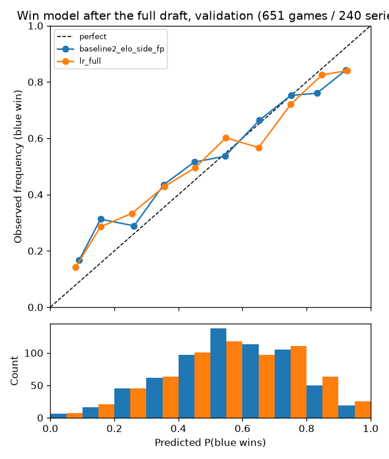

# M3 models report

Generated by `python -m draft_analyzer.report m3` from the results of `python -m draft_analyzer.experiments m3na` and `m3win`.

Rules applied throughout: time-based splits by series start; every comparison is a paired bootstrap over SERIES (2000 resamples, 95% CI on the metric difference); a model "beats" another only if the CI excludes zero, otherwise it is a tie and the simpler one is kept. `diff` is always model minus reference (negative is better for log loss / Brier, positive is better for top-k / accuracy).

## Splits

| split | from | to | games | series | actions | candidate_rows |
|---|---|---|---|---|---|---|
| train | 2024-01-13 | 2026-07-19 | 6349 | 2626 | 126942 | 19898964 |
| val | 2026-07-22 | 2026-09-13 | 651 | 240 | 13018 | 1999546 |
| test | 2026-09-17 | 2026-11-09 | 172 | 66 | 3440 | 524240 |
| (tune, inside train) | 2026-04-01 | 2026-07-19 | 1087 | 425 | 21737 | 3357658 |

## 1. Next pick/ban model (validation: 651 games / 240 series, 13015 actions)

LightGBM scoring (draft state, candidate champion) pairs with a listwise softmax cross-entropy objective over the available candidates (custom objective; outputs are probabilities). Training samples 60 negatives per action with an importance-weight correction; evaluation always uses every available champion (about 156 per action).

Final configuration: regime **fearless_only**, **one joint model**.

### 1.1 Final model vs baselines

| model | metric | value | diff | ci_low | ci_high | verdict |
|---|---|---|---|---|---|---|
| B_presence_team | top1 | 0.1196 | 0.0000 | 0.0000 | 0.0000 | baseline |
| B_presence_team | top5 | 0.3965 | 0.0000 | 0.0000 | 0.0000 | baseline |
| B_presence_team | top10 | 0.5813 | 0.0000 | 0.0000 | 0.0000 | baseline |
| B_presence_team | log_loss | 3.5275 | 0.0000 | 0.0000 | 0.0000 | baseline |
| A_presence | top1 | 0.1088 | -0.0108 | -0.0154 | -0.0060 | worse |
| A_presence | top5 | 0.3731 | -0.0234 | -0.0294 | -0.0174 | worse |
| A_presence | top10 | 0.5604 | -0.0209 | -0.0267 | -0.0149 | worse |
| A_presence | log_loss | 3.5822 | 0.0547 | 0.0441 | 0.0650 | worse |
| model | top1 | 0.2707 | 0.1511 | 0.1437 | 0.1592 | better |
| model | top5 | 0.6626 | 0.2662 | 0.2567 | 0.2756 | better |
| model | top10 | 0.8310 | 0.2497 | 0.2409 | 0.2587 | better |
| model | log_loss | 2.5662 | -0.9613 | -0.9845 | -0.9384 | better |

By action type and draft phase (final model):

| group | slice | top1 | top5 | top10 | log_loss | n_actions | n_games | n_series |
|---|---|---|---|---|---|---|---|---|
| overall | all | 0.2707 | 0.6626 | 0.8310 | 2.5662 | 13015 | 651 | 240 |
| action_type | ban | 0.2675 | 0.6735 | 0.8407 | 2.5286 | 6505 | 651 | 240 |
| action_type | pick | 0.2739 | 0.6518 | 0.8212 | 2.6039 | 6510 | 651 | 240 |
| phase | ban1 | 0.3208 | 0.7274 | 0.8750 | 2.3199 | 3903 | 651 | 240 |
| phase | pick1 | 0.2998 | 0.6726 | 0.8367 | 2.5090 | 3906 | 651 | 240 |
| phase | ban2 | 0.1875 | 0.5926 | 0.7894 | 2.8416 | 2602 | 651 | 240 |
| phase | pick2 | 0.2350 | 0.6206 | 0.7980 | 2.7461 | 2604 | 651 | 240 |

Same slices for baseline B, for reference:

| group | slice | top1 | top5 | top10 | log_loss | n_actions | n_games | n_series |
|---|---|---|---|---|---|---|---|---|
| overall | all | 0.1196 | 0.3965 | 0.5813 | 3.5275 | 13015 | 651 | 240 |
| action_type | ban | 0.1453 | 0.4652 | 0.6561 | 3.3227 | 6505 | 651 | 240 |
| action_type | pick | 0.0939 | 0.3278 | 0.5065 | 3.7322 | 6510 | 651 | 240 |
| phase | ban1 | 0.1996 | 0.5844 | 0.7745 | 2.9808 | 3903 | 651 | 240 |
| phase | pick1 | 0.1249 | 0.4017 | 0.5773 | 3.5272 | 3906 | 651 | 240 |
| phase | ban2 | 0.0638 | 0.2863 | 0.4785 | 3.8356 | 2602 | 651 | 240 |
| phase | pick2 | 0.0472 | 0.2170 | 0.4002 | 4.0397 | 2604 | 651 | 240 |

Model vs baseline B within each slice:

| slice | metric | model | baseline_B | diff | ci_low | ci_high | beats_B |
|---|---|---|---|---|---|---|---|
| ban | top1 | 0.2675 | 0.1453 | 0.1222 | 0.1095 | 0.1342 | True |
| ban | top5 | 0.6735 | 0.4652 | 0.2083 | 0.1947 | 0.2227 | True |
| ban | log_loss | 2.5286 | 3.3227 | -0.7942 | -0.8272 | -0.7621 | True |
| pick | top1 | 0.2739 | 0.0939 | 0.1800 | 0.1696 | 0.1905 | True |
| pick | top5 | 0.6518 | 0.3278 | 0.3240 | 0.3098 | 0.3376 | True |
| pick | log_loss | 2.6039 | 3.7322 | -1.1283 | -1.1620 | -1.0940 | True |
| ban1 | top1 | 0.3208 | 0.1996 | 0.1212 | 0.1025 | 0.1392 | True |
| ban1 | top5 | 0.7274 | 0.5844 | 0.1430 | 0.1256 | 0.1611 | True |
| ban1 | log_loss | 2.3199 | 2.9808 | -0.6609 | -0.7052 | -0.6179 | True |
| pick1 | top1 | 0.2998 | 0.1249 | 0.1749 | 0.1607 | 0.1885 | True |
| pick1 | top5 | 0.6726 | 0.4017 | 0.2709 | 0.2530 | 0.2876 | True |
| pick1 | log_loss | 2.5090 | 3.5272 | -1.0182 | -1.0603 | -0.9755 | True |
| ban2 | top1 | 0.1875 | 0.0638 | 0.1238 | 0.1074 | 0.1399 | True |
| ban2 | top5 | 0.5926 | 0.2863 | 0.3063 | 0.2872 | 0.3272 | True |
| ban2 | log_loss | 2.8416 | 3.8356 | -0.9940 | -1.0400 | -0.9496 | True |
| pick2 | top1 | 0.2350 | 0.0472 | 0.1878 | 0.1711 | 0.2059 | True |
| pick2 | top5 | 0.6206 | 0.2170 | 0.4036 | 0.3796 | 0.4277 | True |
| pick2 | log_loss | 2.7461 | 4.0397 | -1.2935 | -1.3448 | -1.2397 | True |

### 1.2 Regime handling: does pre-Fearless data help?

- **fearless_only**: train on games from 2025-01-01 (hard Fearless era) only.
- **all_decay365**: train on all games (2024 included) with time-decay weights (half-life 365 days); the Fearless mode is a feature (`series_fearless`).
- **all_nodecay**: all games, equal weights (extra reference).

| model | metric | value | diff | ci_low | ci_high | verdict |
|---|---|---|---|---|---|---|
| fearless_only | top1 | 0.2707 | 0.0000 | 0.0000 | 0.0000 | baseline |
| fearless_only | top5 | 0.6626 | 0.0000 | 0.0000 | 0.0000 | baseline |
| fearless_only | top10 | 0.8310 | 0.0000 | 0.0000 | 0.0000 | baseline |
| fearless_only | log_loss | 2.5662 | 0.0000 | 0.0000 | 0.0000 | baseline |
| all_decay365 | top1 | 0.2715 | 0.0008 | -0.0040 | 0.0056 | tie |
| all_decay365 | top5 | 0.6571 | -0.0055 | -0.0102 | -0.0006 | worse |
| all_decay365 | top10 | 0.8283 | -0.0027 | -0.0060 | 0.0006 | tie |
| all_decay365 | log_loss | 2.5795 | 0.0133 | 0.0082 | 0.0182 | worse |
| all_nodecay | top1 | 0.2692 | -0.0015 | -0.0069 | 0.0038 | tie |
| all_nodecay | top5 | 0.6562 | -0.0065 | -0.0111 | -0.0018 | worse |
| all_nodecay | top10 | 0.8287 | -0.0023 | -0.0057 | 0.0009 | tie |
| all_nodecay | log_loss | 2.5767 | 0.0105 | 0.0049 | 0.0166 | worse |

| run | train_actions | early_stop_round | tune_log_loss | seconds |
|---|---|---|---|---|
| gbm_fearless_only | 88675 | 633 | 2.6006 | 148 |
| gbm_all_decay365 | 126942 | 469 | 2.5938 | 173 |
| gbm_all_nodecay | 126942 | 661 | 2.5853 | 206 |

Decision rule: keep the all-games variant only if it beats fearless-only on log loss with a CI excluding zero. Kept: **fearless_only**.

### 1.3 One joint model vs separate pick and ban models

| model | metric | value | diff | ci_low | ci_high | verdict |
|---|---|---|---|---|---|---|
| joint | top1 | 0.2707 | 0.0000 | 0.0000 | 0.0000 | baseline |
| joint | top5 | 0.6626 | 0.0000 | 0.0000 | 0.0000 | baseline |
| joint | top10 | 0.8310 | 0.0000 | 0.0000 | 0.0000 | baseline |
| joint | log_loss | 2.5662 | 0.0000 | 0.0000 | 0.0000 | baseline |
| separate | top1 | 0.2678 | -0.0028 | -0.0087 | 0.0029 | tie |
| separate | top5 | 0.6624 | -0.0002 | -0.0054 | 0.0047 | tie |
| separate | top10 | 0.8312 | 0.0002 | -0.0034 | 0.0039 | tie |
| separate | log_loss | 2.5701 | 0.0038 | -0.0034 | 0.0111 | tie |

Separate models kept: **False** (they are kept only if they win on log loss).

### 1.4 Ablation: which feature groups earn their place

Each row retrains the joint model without one feature group (same recipe and number of rounds) and compares it with the full model on validation. `diff` = without minus full.

| removed_group | without | full | diff | ci_low | ci_high | verdict |
|---|---|---|---|---|---|---|
| champion meta strength | 2.8130 | 2.5662 | 0.2468 | 0.2281 | 0.2664 | earns its place |
| champion attributes (Data Dragon tags) | 2.5729 | 2.5662 | 0.0067 | 0.0018 | 0.0115 | earns its place |
| role fit / role distributions | 2.6779 | 2.5662 | 0.1117 | 0.1036 | 0.1200 | earns its place |
| team tendency | 2.5931 | 2.5662 | 0.0269 | 0.0204 | 0.0338 | earns its place |
| player comfort / mastery | 2.5897 | 2.5662 | 0.0235 | 0.0171 | 0.0304 | earns its place |
| synergy / counter (pairwise) | 2.7110 | 2.5662 | 0.1448 | 0.1336 | 0.1561 | earns its place |
| team strength (Elo) | 2.5738 | 2.5662 | 0.0076 | 0.0023 | 0.0129 | earns its place |
| series context (Fearless burns, earlier bans, score) | 2.5943 | 2.5662 | 0.0280 | 0.0212 | 0.0347 | earns its place |

Top-1 and top-5:

| removed_group | metric | without | full | diff | ci_low | ci_high | verdict |
|---|---|---|---|---|---|---|---|
| champion meta strength | top1 | 0.2289 | 0.2707 | -0.0418 | -0.0490 | -0.0345 | earns its place |
| champion meta strength | top5 | 0.5988 | 0.6626 | -0.0638 | -0.0723 | -0.0554 | earns its place |
| champion attributes (Data Dragon tags) | top1 | 0.2718 | 0.2707 | 0.0011 | -0.0041 | 0.0061 | tie |
| champion attributes (Data Dragon tags) | top5 | 0.6588 | 0.6626 | -0.0038 | -0.0086 | 0.0010 | tie |
| role fit / role distributions | top1 | 0.2571 | 0.2707 | -0.0136 | -0.0187 | -0.0083 | earns its place |
| role fit / role distributions | top5 | 0.6348 | 0.6626 | -0.0278 | -0.0338 | -0.0222 | earns its place |
| team tendency | top1 | 0.2690 | 0.2707 | -0.0017 | -0.0072 | 0.0037 | tie |
| team tendency | top5 | 0.6509 | 0.6626 | -0.0117 | -0.0165 | -0.0068 | earns its place |
| player comfort / mastery | top1 | 0.2711 | 0.2707 | 0.0004 | -0.0058 | 0.0067 | tie |
| player comfort / mastery | top5 | 0.6531 | 0.6626 | -0.0095 | -0.0152 | -0.0042 | earns its place |
| synergy / counter (pairwise) | top1 | 0.2326 | 0.2707 | -0.0381 | -0.0444 | -0.0316 | earns its place |
| synergy / counter (pairwise) | top5 | 0.6174 | 0.6626 | -0.0452 | -0.0523 | -0.0385 | earns its place |
| team strength (Elo) | top1 | 0.2701 | 0.2707 | -0.0005 | -0.0052 | 0.0043 | tie |
| team strength (Elo) | top5 | 0.6604 | 0.6626 | -0.0022 | -0.0068 | 0.0023 | tie |
| series context (Fearless burns, earlier bans, score) | top1 | 0.2674 | 0.2707 | -0.0033 | -0.0083 | 0.0021 | tie |
| series context (Fearless burns, earlier bans, score) | top5 | 0.6546 | 0.6626 | -0.0080 | -0.0128 | -0.0032 | earns its place |

The pairwise group split in two (log loss), because the spec asks whether pro-only synergy and counter statistics help at all:

| removed | without | full | diff | ci_low | ci_high | verdict |
|---|---|---|---|---|---|---|
| win-based synergy/counter only (pair_syn_*, pair_ctr_*) | 2.5686 | 2.5662 | 0.0024 | -0.0027 | 0.0075 | tie |
| co-draft frequency only (pair_colift_*, pair_vslift_*, pair_evidence_*) | 2.7101 | 2.5662 | 0.1439 | 0.1325 | 0.1552 | earns its place |

So the win-based synergy/counter estimates (the ones pro samples are too small for) add nothing measurable; the whole gain of the group comes from how often champions are drafted together or into each other, which is a statement about drafting habits, not about winning.

For scale, a model with ONLY champion-meta and draft-position features scores log loss 3.2654 (full model 2.5662; diff +0.6991, CI [+0.6771, +0.7213]).

### 1.5 Feature importance

By group (gain share; summed mean |SHAP| on 1,500 validation actions):

| group | gain_share | mean_abs_shap | n_features |
|---|---|---|---|
| champion meta strength | 0.6136 | 2.5725 | 14 |
| role fit | 0.1236 | 1.2549 | 18 |
| team tendency | 0.0480 | 0.5271 | 10 |
| draft context | 0.0774 | 0.4877 | 9 |
| synergy/counter | 0.0726 | 0.4785 | 10 |
| player comfort | 0.0301 | 0.4530 | 12 |
| series context | 0.0304 | 0.1852 | 8 |
| team strength | 0.0025 | 0.0407 | 3 |
| champion attributes | 0.0018 | 0.0324 | 7 |

Top 25 features:

| feature | group | gain | mean_abs_shap |
|---|---|---|---|
| meta_rate_action | champion meta strength | 0.2161 | 0.5269 |
| meta_presence_patch_raw | champion meta strength | 0.1638 | 0.2045 |
| meta_presence_recent | champion meta strength | 0.1026 | 0.7483 |
| meta_rate_type | champion meta strength | 0.0583 | 0.1346 |
| ctx_action_index | draft context | 0.0414 | 0.2249 |
| role_fit_own | role fit | 0.0406 | 0.3861 |
| meta_rate_phase_slot | champion meta strength | 0.0385 | 0.0335 |
| role_fit_opp | role fit | 0.0378 | 0.1909 |
| pair_colift_own | synergy/counter | 0.0355 | 0.1001 |
| ctx_is_pick | draft context | 0.0234 | 0.1455 |
| series_ban_own_prev | series context | 0.0222 | 0.0196 |
| meta_presence_long | champion meta strength | 0.0144 | 0.2769 |
| pair_colift_opp | synergy/counter | 0.0123 | 0.0482 |
| team_pick_rate_opp_recent | team tendency | 0.0122 | 0.1508 |
| team_banned_against_opp | team tendency | 0.0117 | 0.0835 |
| pair_vslift_opp | synergy/counter | 0.0095 | 0.0997 |
| pair_evidence_own | synergy/counter | 0.0075 | 0.1493 |
| meta_presence_league | champion meta strength | 0.0073 | 0.3847 |
| player_share_own | player comfort | 0.0071 | 0.0632 |
| role_p_sup | role fit | 0.0070 | 0.0639 |
| team_pick_rate_own_recent | team tendency | 0.0068 | 0.0847 |
| player_win_resid_own | player comfort | 0.0061 | 0.0401 |
| team_ban_rate_own | team tendency | 0.0058 | 0.0580 |
| player_win_resid_opp | player comfort | 0.0053 | 0.0486 |
| role_p_jng | role fit | 0.0053 | 0.0417 |

### 1.6 Are the probabilities honest?

Top-1 confidence vs accuracy on validation (joint model). A calibrated model has the two columns equal.

| bin | actions | mean_top1_prob | top1_accuracy |
|---|---|---|---|
| [0.0, 0.1) | 87 | 0.0917 | 0.1149 |
| [0.1, 0.2) | 4096 | 0.1603 | 0.1550 |
| [0.2, 0.3) | 4304 | 0.2454 | 0.2224 |
| [0.3, 0.4) | 2215 | 0.3444 | 0.3214 |
| [0.4, 0.5) | 1147 | 0.4440 | 0.4281 |
| [0.5, 0.6) | 574 | 0.5428 | 0.5279 |
| [0.6, 0.8) | 478 | 0.6791 | 0.6715 |
| [0.8, 1.0) | 114 | 0.8627 | 0.8246 |

### 1.7 Failure cases: confidently wrong (validation)

The 15 actions where the model put the most probability on a champion that was not chosen:

| game | action | predicted | p_pred | actual | p_actual | rank_actual |
|---|---|---|---|---|---|---|
| LCK 2026-08-20 Nongshim RedForce vs Kiwoom DRX g2 | 10 (Red pick) | Bard | 0.902 | Shen | 0.015 | 3 |
| LPL 2026-08-28 Invictus Gaming vs ThunderTalk Gaming g2 | 8 (Blue pick) | Seraphine | 0.890 | Naafiri | 0.026 | 2 |
| LEC 2026-08-30 Team Heretics vs Movistar KOI g1 | 18 (Blue pick) | Milio | 0.886 | Nami | 0.022 | 2 |
| LCP 2026-07-26 GAM Esports vs DetonatioN FocusMe g2 | 3 (Blue ban) | Orianna | 0.881 | Rumble | 0.006 | 7 |
| LPL 2026-09-03 Bilibili Gaming vs Team WE g3 | 6 (Blue pick) | Orianna | 0.876 | Jayce | 0.008 | 7 |
| LCP 2026-07-31 CTBC Flying Oyster vs GAM Esports g3 | 6 (Red pick) | Orianna | 0.859 | Varus | 0.035 | 2 |
| LEC 2026-08-23 GiantX vs Team Heretics g2 | 11 (Red pick) | Milio | 0.857 | Leona | 0.016 | 2 |
| LPL 2026-07-22 Top Esports vs Team WE g2 | 1 (Blue ban) | Orianna | 0.857 | Naafiri | 0.021 | 4 |
| LCK 2026-08-01 BNK FEARX vs Nongshim RedForce g3 | 6 (Red pick) | Orianna | 0.852 | Locke | 0.039 | 3 |
| LEC 2026-07-31 Team Vitality vs Team Heretics g2 | 6 (Blue pick) | Orianna | 0.832 | Cassiopeia | 0.047 | 3 |
| LPL 2026-09-06 Ninjas in Pyjamas vs LGD Gaming g5 | 8 (Blue pick) | Vi | 0.831 | Rakan | 0.027 | 3 |
| LCS 2026-08-29 Team Liquid vs Shopify Rebellion g3 | 9 (Red pick) | Milio | 0.829 | Skarner | 0.010 | 5 |
| LPL 2026-08-30 Team WE vs JD Gaming g3 | 6 (Red pick) | Orianna | 0.824 | Olaf | 0.024 | 2 |
| LCK 2026-08-05 Nongshim RedForce vs HANJIN BRION g3 | 8 (Red pick) | Milio | 0.819 | Xin Zhao | 0.047 | 2 |
| LCP 2026-07-26 GAM Esports vs DetonatioN FocusMe g2 | 5 (Blue ban) | Orianna | 0.819 | Vi | 0.024 | 3 |

Surprises: in 56 of 13015 validation actions (0.4%) the chosen champion was ranked below 50. By phase: {"pick2": 29, "ban2": 12, "pick1": 10, "ban1": 5}. Most frequent surprise champions: LeBlanc (3), Kai'Sa (3), Locke (2), Xerath (2), Volibear (2), Seraphine (2), Taliyah (2), Kalista (2).

When the model is at least 50% confident (1166 actions) it is right 61.6% of the time (mean confidence 63.0%).

### 1.8 Test split, scored once (172 games / 66 series, 3440 actions; Worlds 2026 and later)

| model | metric | value | diff | ci_low | ci_high | verdict |
|---|---|---|---|---|---|---|
| B_presence_team | top1 | 0.1416 | 0.0000 | 0.0000 | 0.0000 | baseline |
| B_presence_team | top5 | 0.3948 | 0.0000 | 0.0000 | 0.0000 | baseline |
| B_presence_team | top10 | 0.5698 | 0.0000 | 0.0000 | 0.0000 | baseline |
| B_presence_team | log_loss | 3.5249 | 0.0000 | 0.0000 | 0.0000 | baseline |
| A_presence | top1 | 0.1250 | -0.0166 | -0.0240 | -0.0087 | worse |
| A_presence | top5 | 0.3738 | -0.0209 | -0.0311 | -0.0103 | worse |
| A_presence | top10 | 0.5520 | -0.0177 | -0.0288 | -0.0067 | worse |
| A_presence | log_loss | 3.5812 | 0.0563 | 0.0388 | 0.0737 | worse |
| model | top1 | 0.2654 | 0.1238 | 0.1108 | 0.1382 | better |
| model | top5 | 0.6451 | 0.2503 | 0.2360 | 0.2651 | better |
| model | top10 | 0.8270 | 0.2573 | 0.2422 | 0.2728 | better |
| model | log_loss | 2.5847 | -0.9402 | -0.9722 | -0.9093 | better |

| group | slice | top1 | top5 | top10 | log_loss | n_actions | n_games | n_series |
|---|---|---|---|---|---|---|---|---|
| overall | all | 0.2654 | 0.6451 | 0.8270 | 2.5847 | 3440 | 172 | 66 |
| action_type | ban | 0.2605 | 0.6488 | 0.8203 | 2.6014 | 1720 | 172 | 66 |
| action_type | pick | 0.2703 | 0.6413 | 0.8337 | 2.5680 | 1720 | 172 | 66 |
| phase | ban1 | 0.3033 | 0.7045 | 0.8372 | 2.4394 | 1032 | 172 | 66 |
| phase | pick1 | 0.3130 | 0.6541 | 0.8343 | 2.4912 | 1032 | 172 | 66 |
| phase | ban2 | 0.1962 | 0.5654 | 0.7951 | 2.8445 | 688 | 172 | 66 |
| phase | pick2 | 0.2064 | 0.6221 | 0.8328 | 2.6832 | 688 | 172 | 66 |

## 2. Win probability model (validation: 651 games / 240 series)

Target: P(blue side wins). Rows are (game, draft checkpoint k): k=0 before the draft, 6 after ban phase 1, 12 after pick phase 1, 16 after ban phase 2, 20 after the full draft. Draft features are sums over the picks locked so far (zero at k=0), so one model serves every point of the draft.

- **baseline1_elo**: Elo difference only. **baseline2_elo_side_fp**: Elo + side + first pick (the reference).
- **lr_pregame_only**: logistic regression on all pre-game features (Elo, first pick, games played, series score).
- **lr_full**: logistic regression on pre-game + draft features (L2 strength C=0.1, chosen on the tune period; Elo and first pick are left unpenalised).
- **gbm_full**: LightGBM on the same features (4 leaves, 297 rounds by early stopping on tune).

Draft features: `meta_win_resid_sum_diff`, `meta_win_resid_patch_sum_diff`, `meta_presence_sum_diff`, `team_comfort_sum_diff`, `player_mastery_sum_diff`, `player_win_resid_sum_diff`, `pair_syn_sum_diff`, `pair_ctr_sum`

### 2.1 Log loss vs baseline 2 at each draft checkpoint

| k | model | log_loss | baseline2 | diff | ci_low | ci_high | verdict |
|---|---|---|---|---|---|---|---|
| 0 | lr_pregame_only | 0.6420 | 0.6415 | 0.0004 | -0.0019 | 0.0028 | tie |
| 0 | lr_full | 0.6402 | 0.6415 | -0.0013 | -0.0041 | 0.0013 | tie |
| 0 | gbm_full | 0.6328 | 0.6415 | -0.0087 | -0.0165 | -0.0015 | better |
| 6 | lr_pregame_only | 0.6420 | 0.6415 | 0.0004 | -0.0019 | 0.0028 | tie |
| 6 | lr_full | 0.6402 | 0.6415 | -0.0013 | -0.0041 | 0.0013 | tie |
| 6 | gbm_full | 0.6328 | 0.6415 | -0.0087 | -0.0165 | -0.0015 | better |
| 12 | lr_pregame_only | 0.6420 | 0.6415 | 0.0004 | -0.0019 | 0.0028 | tie |
| 12 | lr_full | 0.6360 | 0.6415 | -0.0055 | -0.0115 | 0.0003 | tie |
| 12 | gbm_full | 0.6283 | 0.6415 | -0.0133 | -0.0217 | -0.0047 | better |
| 16 | lr_pregame_only | 0.6420 | 0.6415 | 0.0004 | -0.0019 | 0.0028 | tie |
| 16 | lr_full | 0.6360 | 0.6415 | -0.0055 | -0.0115 | 0.0003 | tie |
| 16 | gbm_full | 0.6283 | 0.6415 | -0.0133 | -0.0217 | -0.0047 | better |
| 20 | lr_pregame_only | 0.6420 | 0.6415 | 0.0004 | -0.0019 | 0.0028 | tie |
| 20 | lr_full | 0.6370 | 0.6415 | -0.0045 | -0.0133 | 0.0045 | tie |
| 20 | gbm_full | 0.6294 | 0.6415 | -0.0121 | -0.0212 | -0.0030 | better |

All metrics after the full draft (k=20):

| model | log_loss | brier | accuracy | n_games | n_series |
|---|---|---|---|---|---|
| baseline1_elo | 0.6456 | 0.2267 | 0.6052 | 651 | 240 |
| baseline2_elo_side_fp | 0.6415 | 0.2246 | 0.6329 | 651 | 240 |
| lr_pregame_only | 0.6420 | 0.2248 | 0.6283 | 651 | 240 |
| lr_full | 0.6370 | 0.2228 | 0.6344 | 651 | 240 |
| gbm_full | 0.6294 | 0.2201 | 0.6298 | 651 | 240 |

| model | metric | value | diff | ci_low | ci_high | verdict |
|---|---|---|---|---|---|---|
| baseline1_elo | log_loss | 0.6456 | 0.0041 | -0.0010 | 0.0094 | tie |
| baseline1_elo | brier | 0.2267 | 0.0020 | -0.0002 | 0.0043 | tie |
| baseline1_elo | accuracy | 0.6052 | -0.0276 | -0.0521 | -0.0047 | worse |
| baseline2_elo_side_fp | log_loss | 0.6415 | 0.0000 | 0.0000 | 0.0000 | baseline |
| baseline2_elo_side_fp | brier | 0.2246 | 0.0000 | 0.0000 | 0.0000 | baseline |
| baseline2_elo_side_fp | accuracy | 0.6329 | 0.0000 | 0.0000 | 0.0000 | baseline |
| lr_pregame_only | log_loss | 0.6420 | 0.0004 | -0.0019 | 0.0028 | tie |
| lr_pregame_only | brier | 0.2248 | 0.0002 | -0.0009 | 0.0012 | tie |
| lr_pregame_only | accuracy | 0.6283 | -0.0046 | -0.0156 | 0.0061 | tie |
| lr_full | log_loss | 0.6370 | -0.0045 | -0.0133 | 0.0045 | tie |
| lr_full | brier | 0.2228 | -0.0018 | -0.0058 | 0.0019 | tie |
| lr_full | accuracy | 0.6344 | 0.0015 | -0.0249 | 0.0257 | tie |
| gbm_full | log_loss | 0.6294 | -0.0121 | -0.0212 | -0.0030 | better |
| gbm_full | brier | 0.2201 | -0.0046 | -0.0079 | -0.0012 | better |
| gbm_full | accuracy | 0.6298 | -0.0031 | -0.0204 | 0.0141 | tie |

### 2.2 Does knowing the draft improve the prediction?

The cleanest test: the same model's prediction after the full draft (k=20) vs before it (k=0), paired by game.

| model | metric | after_draft | before_draft | diff | ci_low | ci_high | significant |
|---|---|---|---|---|---|---|---|
| lr_full | log_loss | 0.6370 | 0.6402 | -0.0032 | -0.0124 | 0.0058 | False |
| lr_full | brier | 0.2228 | 0.2243 | -0.0015 | -0.0053 | 0.0023 | False |
| gbm_full | log_loss | 0.6294 | 0.6328 | -0.0034 | -0.0086 | 0.0018 | False |
| gbm_full | brier | 0.2201 | 0.2217 | -0.0016 | -0.0039 | 0.0007 | False |

Size of the reported draft effect (lr_full minus baseline 2, after the full draft): mean absolute 0.043, 90th percentile 0.091, max 0.167 (probability points x100 = percentage points).

### 2.3 LightGBM vs logistic regression

| k | gbm_full | lr_full | diff | ci_low | ci_high | significant |
|---|---|---|---|---|---|---|
| 0 | 0.6328 | 0.6402 | -0.0074 | -0.0140 | -0.0009 | True |
| 20 | 0.6294 | 0.6370 | -0.0076 | -0.0163 | 0.0008 | False |

### 2.4 Ablation of draft feature groups (lr_full, k=20) and coefficients

| removed_draft_group | without | full | diff | ci_low | ci_high | verdict |
|---|---|---|---|---|---|---|
| champion meta strength | 0.6381 | 0.6370 | 0.0011 | -0.0008 | 0.0029 | tie |
| player comfort | 0.6366 | 0.6370 | -0.0004 | -0.0058 | 0.0049 | tie |
| synergy/counter | 0.6388 | 0.6370 | 0.0018 | -0.0017 | 0.0056 | tie |
| team tendency | 0.6368 | 0.6370 | -0.0002 | -0.0028 | 0.0024 | tie |

Standardised coefficients of lr_full (change in log-odds of a blue win per 1 SD):

| feature | coef_per_sd | group |
|---|---|---|
| elo_diff | 0.7391 | team strength |
| player_mastery_sum_diff | 0.1351 | player comfort |
| team_comfort_sum_diff | -0.0867 | team tendency |
| meta_win_resid_sum_diff | 0.0511 | champion meta strength |
| ctx_blue_first_pick | 0.0474 | draft context |
| series_wins_diff | 0.0473 | series context |
| pair_syn_sum_diff | 0.0436 | synergy/counter |
| pair_ctr_sum | 0.0424 | synergy/counter |
| elo_games_min | 0.0406 | team strength |
| player_win_resid_sum_diff | 0.0284 | player comfort |
| meta_win_resid_patch_sum_diff | -0.0233 | champion meta strength |
| meta_presence_sum_diff | -0.0190 | champion meta strength |

### 2.5 Calibration (k=20)

| model | bin_low | bin_high | n | mean_pred | obs_freq |
|---|---|---|---|---|---|
| baseline2_elo_side_fp | 0.0000 | 0.1000 | 6 | 0.0897 | 0.1667 |
| baseline2_elo_side_fp | 0.1000 | 0.2000 | 16 | 0.1566 | 0.3125 |
| baseline2_elo_side_fp | 0.2000 | 0.3000 | 45 | 0.2615 | 0.2889 |
| baseline2_elo_side_fp | 0.3000 | 0.4000 | 62 | 0.3543 | 0.4355 |
| baseline2_elo_side_fp | 0.4000 | 0.5000 | 97 | 0.4496 | 0.5155 |
| baseline2_elo_side_fp | 0.5000 | 0.6000 | 138 | 0.5451 | 0.5362 |
| baseline2_elo_side_fp | 0.6000 | 0.7000 | 113 | 0.6523 | 0.6637 |
| baseline2_elo_side_fp | 0.7000 | 0.8000 | 105 | 0.7512 | 0.7524 |
| baseline2_elo_side_fp | 0.8000 | 0.9000 | 50 | 0.8324 | 0.7600 |
| baseline2_elo_side_fp | 0.9000 | 1.0000 | 19 | 0.9224 | 0.8421 |
| lr_full | 0.0000 | 0.1000 | 8 | 0.0777 | 0.1250 |
| lr_full | 0.1000 | 0.2000 | 23 | 0.1613 | 0.2609 |
| lr_full | 0.2000 | 0.3000 | 45 | 0.2559 | 0.4000 |
| lr_full | 0.3000 | 0.4000 | 68 | 0.3575 | 0.3824 |
| lr_full | 0.4000 | 0.5000 | 93 | 0.4539 | 0.5376 |
| lr_full | 0.5000 | 0.6000 | 119 | 0.5465 | 0.5714 |
| lr_full | 0.6000 | 0.7000 | 88 | 0.6504 | 0.5909 |
| lr_full | 0.7000 | 0.8000 | 115 | 0.7492 | 0.7130 |
| lr_full | 0.8000 | 0.9000 | 64 | 0.8485 | 0.7969 |
| lr_full | 0.9000 | 1.0000 | 28 | 0.9276 | 0.8571 |

### 2.6 Test split, scored once (172 games / 66 series; Worlds 2026 and later)

| model | log_loss | brier | accuracy | n_games | n_series |
|---|---|---|---|---|---|
| baseline1_elo | 0.6726 | 0.2401 | 0.6105 | 172 | 66 |
| baseline2_elo_side_fp | 0.6639 | 0.2357 | 0.6105 | 172 | 66 |
| lr_pregame_only | 0.6626 | 0.2351 | 0.6047 | 172 | 66 |
| lr_full | 0.6776 | 0.2413 | 0.5988 | 172 | 66 |
| gbm_full | 0.6749 | 0.2406 | 0.5930 | 172 | 66 |

| model | metric | value | diff | ci_low | ci_high | verdict |
|---|---|---|---|---|---|---|
| baseline1_elo | log_loss | 0.6726 | 0.0087 | -0.0019 | 0.0197 | tie |
| baseline1_elo | brier | 0.2401 | 0.0044 | -0.0005 | 0.0095 | tie |
| baseline2_elo_side_fp | log_loss | 0.6639 | 0.0000 | 0.0000 | 0.0000 | baseline |
| baseline2_elo_side_fp | brier | 0.2357 | 0.0000 | 0.0000 | 0.0000 | baseline |
| lr_pregame_only | log_loss | 0.6626 | -0.0014 | -0.0062 | 0.0034 | tie |
| lr_pregame_only | brier | 0.2351 | -0.0006 | -0.0029 | 0.0016 | tie |
| lr_full | log_loss | 0.6776 | 0.0136 | -0.0051 | 0.0327 | tie |
| lr_full | brier | 0.2413 | 0.0056 | -0.0029 | 0.0141 | tie |
| gbm_full | log_loss | 0.6749 | 0.0110 | -0.0035 | 0.0255 | tie |
| gbm_full | brier | 0.2406 | 0.0049 | -0.0015 | 0.0113 | tie |
